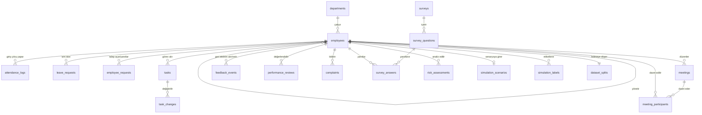

# Mobbing Risk Analizi Sistemi: Veritabanı

Bu klasör projenin veritabanı kısmıdır: bir şirketi simüle eden MySQL veritabanının tabloları, içini dolduran örnek veri ve örnek sorgular. Veritabanı mobbingi kendisi tespit etmez; analiz için gereken veriyi düzenli, ilişkili ve sorgulanabilir biçimde saklar.

## Dosyalar

| Dosya | İçerik |
|---|---|
| `sql/01_schema.sql` | Veritabanı ve 19 tablo |
| `sql/02_seed.sql` | Örnek şirket verisi: 2025 yılı, 200 çalışan |
| `sql/03_queries.sql` | Örnek sorgular: temel listeler, göstergeler, cevap anahtarı, tutarlılık kontrolleri |
| `generator/generate_seed.py` | `02_seed.sql` dosyasını üreten Python betiği |

## Kurulum

Dosyalar sırayla çalıştırılır. MySQL Workbench'te her dosya File > Open SQL Script ile açılır ve şimşek düğmesiyle çalıştırılır. Komut satırından:

```
mysql -u root -p < sql/01_schema.sql
mysql -u root -p < sql/02_seed.sql
mysql -u root -p mobbing_risk < sql/03_queries.sql
```

Veritabanının adı `mobbing_risk`. Baştan kurmak için önce `DROP DATABASE mobbing_risk;` çalıştırılır. Dosyalar MySQL 8 için yazıldı; MariaDB 10.4+ (XAMPP) ile uyumlu SQL özellikleri kullanır.

## Tablolar

**Organizasyon**

- `departments`: şirketteki departmanlar.
- `employees`: çalışanlar. `department_id` çalışanın departmanını, `manager_id` yöneticisini gösterir. Yönetici de bir çalışan olduğu için `manager_id` aynı tabloya bakar. Çalışan silinmez; işten ayrılınca `termination_date` doldurulur.

**Zaman**

- `attendance_logs`: günlük giriş ve çıkış saatleri. Bir çalışanın bir güne tek kaydı olur. Standart mesai 09:00 ile 18:00 arasıdır; bunu aşan süre ve hafta sonu çalışması ek mesaidir.
- `leave_requests`: izin başvuruları. `status` başvurunun bekleyen, onaylanan ya da reddedilen olduğunu, `decided_by` kararı veren yöneticiyi gösterir.

**İş**

- `employee_requests`: çalışanların bilgi, onay, kaynak ve planlama talepleri. Oluşturulma, görülme, ilk yanıt ve sonuç zamanlarını ayrı tutar. Böylece yalnız “yanıtlandı mı?” değil, seçici geciktirme ve yanıtsız bırakma da ölçülür.
- `tasks`: görevler. Kime verildi (`assigned_to`), kim verdi (`assigned_by`), ne zaman verildi, ne zaman istendi, ne zaman bitti. Tahmini ve gerçek efor ayrı tutulur.
- `task_changes`: görev verildikten sonra son tarihin kısaltılması/uzatılması, önceliğin artırılması ve yeniden atama olayları.
- `meetings`: toplantılar. Dört türü vardır: ekip (`team`), departman (`department`), proje (`project`), şirket (`company`).
- `meeting_participants`: toplantı davetleri. Davet zamanı, yanıt, davetten çıkarılma ve katılım durumu tutulur. Hiç çağrılmayan ekip üyesinin satırı olmaz.

**Değerlendirme**

- `feedback_events`: övgü, düzeltme, uyarı ve eleştiri olayları; özel, ekip veya departman görünürlüğüyle birlikte tutulur.
- `performance_reviews`: çeyreklik performans puanları (1.0 ile 5.0 arası).
- `complaints`: çalışanların bildirdiği olumsuz olaylar. `reporter_id` bildiren, `accused_id` hakkında bildirim yapılan kişidir.

**Anket**

- `surveys`: anketler.
- `survey_questions`: anket soruları. Sorular olumsuz ifadedir ve 1 ile 5 arasında puanlanır; puan yükseldikçe risk artar. `dimension` sorunun ölçtüğü boyuttur: iş yükü, dışlanma, haklar, adalet, saygı.
- `survey_answers`: çalışanın bir soruya verdiği puan.

**Analiz**

- `risk_assessments`: backend'in ürettiği risk puanı ve LLM raporu. Başlangıçta boştur.
- `simulation_scenarios`, `simulation_labels`, `dataset_splits`: simülasyonun cevap anahtarı. Aşağıda anlatılıyor.

## İlişkiler



Bazı tablolar `employees` tablosuna iki ayrı yabancı anahtarla bağlanır: `employee_requests` (isteyen ve alıcı), `tasks` (alan ve veren), `leave_requests` (başvuran ve karar veren), `feedback_events` (alan ve veren), `performance_reviews` (değerlendirilen ve değerlendiren), `complaints` (bildiren ve hakkında bildirilen).

## Örnek veri

Veri gerçek bir şirketten alınmadı, `generator/generate_seed.py` ile üretildi. 2025 yılı boyunca 9 departmanlı, 200 çalışanlı bir şirket simüle edilir.

| Tablo | Satır |
|---|---|
| departments | 9 |
| employees | 200 |
| attendance_logs | 45 617 |
| leave_requests | 824 |
| employee_requests | 3 951 |
| tasks | 21 189 |
| task_changes | 1 816 |
| meetings | 2 132 |
| meeting_participants | 17 928 |
| feedback_events | 1 995 |
| performance_reviews | 752 |
| complaints | 27 |
| surveys | 2 |
| survey_questions | 20 |
| survey_answers | 3 210 |
| risk_assessments | 0 |
| simulation_scenarios | 20 |
| simulation_labels | 2 291 |
| dataset_splits | 200 |

**Senaryolar.** 200 çalışanın 20'si bir senaryonun içindedir: yöneticisi belirli aylar arasında ona aşağıdaki altı yoldan biri ya da birkaçıyla baskı uygular. Dört yönetici birden çok kişiye baskı uygular.

| Baskı yolu | Veride nasıl görünür |
|---|---|
| Aşırı iş yükü (`has_overload`) | Departman ortalamasının üstünde görev, 24 saat içinde istenen işler, mesai dışında verilen görevler, uzun ek mesai, hafta sonu çalışması |
| Dışlama (`has_exclusion`) | Yöneticisinin ekip toplantılarına çağrılmama, proje toplantılarına daha az davet |
| İzin engelleme (`has_leave_denial`) | İzin başvurularının çoğunun reddedilmesi, kararın günlerce geciktirilmesi |
| Haksız değerlendirme (`has_unfair_evaluation`) | Performans puanının bir önceki çeyreğe göre belirgin düşmesi |
| Talepleri görmezden gelme (`has_request_ignoring`) | Taleplerin geç görülmesi, geç yanıtlanması, yanıtsız veya sonuçsuz bırakılması; aynı alıcının diğer kişilere davranışıyla karşılaştırma |
| Topluluk önünde eleştiri (`has_public_criticism`) | Uyarı ve eleştirilerin özel görüşme yerine ekip/departman görünürlüğünde tekrarlanması |

Senaryodaki çalışanların bir kısmı şikâyette bulunur, anketlerde daha yüksek puan verir, üçü yıl içinde işten ayrılır.

**Zararsız benzer durumlar.** Model yalnızca tek bir sayıya bakıp karar veremesin diye mobbing olmayan ama ona benzeyen durumlar da vardır: bütün ekibin yoğun çalıştığı dönemler (Yazılım Geliştirme Ekim ve Kasım, Satış Haziran, Finans Aralık), her zaman çok çalışan 10 kişi, puanı yıl boyu düşük olan 10 kişi, sıradan acil görev ve görev değişiklikleri, yoğun dönemde geciken talepler, özel düzeltmeler, kaçırılan toplantılar ve senaryoyla ilgisi olmayan şikâyetler. Hiçbir yeni gösterge tek başına etiketi kesin olarak ele vermez.

**Cevap anahtarı.** Gerçek bir şirkette aşağıdaki üç tablo olmaz; simülasyonda doğru cevabı bildiğimiz için vardır.

- `simulation_scenarios`: kime, kim tarafından, hangi aylar arasında, hangi yollarla baskı uygulandı.
- `simulation_labels`: her çalışan ve her ay için tek satır. `is_mobbing = 1` ise çalışan o ay bir senaryonun içindedir. 2 291 çalışan-ayın 139'u böyledir.
- `dataset_splits`: çalışanların yüzde 70'i eğitim (`train`), 15'i doğrulama (`validation`), 15'i kullanım (`test`) bölmesindedir. Bölme çalışan bazında yapıldı ki aynı kişinin ayları hem eğitimde hem sınamada yer almasın.

| Bölme | Çalışan | Çalışan-ay | Mobbing etiketli ay |
|---|---|---|---|
| train | 140 | 1 582 | 93 |
| validation | 30 | 356 | 21 |
| test | 30 | 353 | 25 |

## Göstergeler

Ön işleme ve backend için her mobbing belirtisinin hangi tablodan, hangi sorguyla çıktığı:

| Gösterge | Tablo | Sorgu (`03_queries.sql`) |
|---|---|---|
| Aylık ek mesai saati, hafta sonu çalışması | attendance_logs | B1 |
| İzin başvurusu ve onay oranı | leave_requests | B2, B3 |
| Görev yükünün departman ortalamasına oranı | tasks, employees | B4 |
| Mesai dışı, dar süreli ve geciken görevler | tasks | B5, B6 |
| Ekip toplantılarından dışlanma oranı | meetings, meeting_participants | B7 |
| Performans puanındaki düşüş | performance_reviews | B8 |
| Hakkındaki şikâyet sayısı | complaints | B9 |
| Anket boyut ortalamaları | survey_answers, survey_questions | B10 |
| Talep görülme/yanıt süresi ve yanıtsızlık | employee_requests | B11 |
| Talep yanıtının aynı alıcının diğer kişilerine göre farkı | employee_requests | B12 |
| Hiç davet edilmeme, davetten çıkarılma, geç davet | meetings, meeting_participants | B13 |
| Gerçek/tahmini efor ve sonradan görev değişiklikleri | tasks, task_changes | B14 |
| Topluluk önünde olumsuz geri bildirim | feedback_events | B15 |
| Talep davranışındaki aylık kötüleşme eğilimi | employee_requests | B16 |

Aylık sorgularda ay, ayın ilk günü olarak yazılır (örnek: `2025-03-01`). `simulation_labels.period_month` ve `risk_assessments.period_month` aynı biçimdedir, böylece göstergeler etiketlerle doğrudan birleştirilir (örnek: sorgu C3).
Sorgu C4, operasyonel tablolardan başlangıç modeli için tek satır/çalışan-ay biçiminde hazır bir özellik matrisi üretir.

## Model için kullanım

Başlangıç modeli yalnız operasyonel ham olayları kullanmalıdır: giriş-çıkış, izin, talep, görev/değişiklik, toplantı daveti, geri bildirim ve performans. Mutlak değerlerin yanında kişinin ekip veya aynı yönetici altındaki çalışanlara göre farkı ve son 2-3 aydaki eğilimi özellik olarak verilmelidir. Örneğin tek başına iki günlük yanıt süresinden çok, yöneticinin diğer kişilere 4 saatte yanıt verirken aynı kişiye sürekli iki günde yanıt vermesi değerlidir.

İkinci bir deneyde şikâyet ve anket özellikleri eklenip sonuçlar karşılaştırılabilir. Bunlar güçlü ama olaydan sonra oluşabilen öznel sinyallerdir; ayrı tutulmaları modelin operasyonel veriden gerçekten örüntü öğrenip öğrenmediğini gösterir.

`simulation_scenarios`, `simulation_labels` ve `dataset_splits` yalnız eğitim cevabı/bölmesi içindir; `risk_assessments` model çıktısıdır. Bu dört tablonun hiçbir sütunu model girdisi yapılmamalıdır. Aksi halde veri sızıntısı oluşur ve ölçülen başarı gerçekçi olmaz.

## Veriyi yeniden üretmek

```
cd generator
python3 generate_seed.py --out ../sql/02_seed.sql
python3 generate_seed.py --employees 300 --seed 7 --out ../sql/02_seed.sql
```

Betik yalnız Python standart kütüphanesini kullanır. Aynı `--seed` değeri aynı veriyi üretir; `--employees` çalışan sayısını değiştirir.
